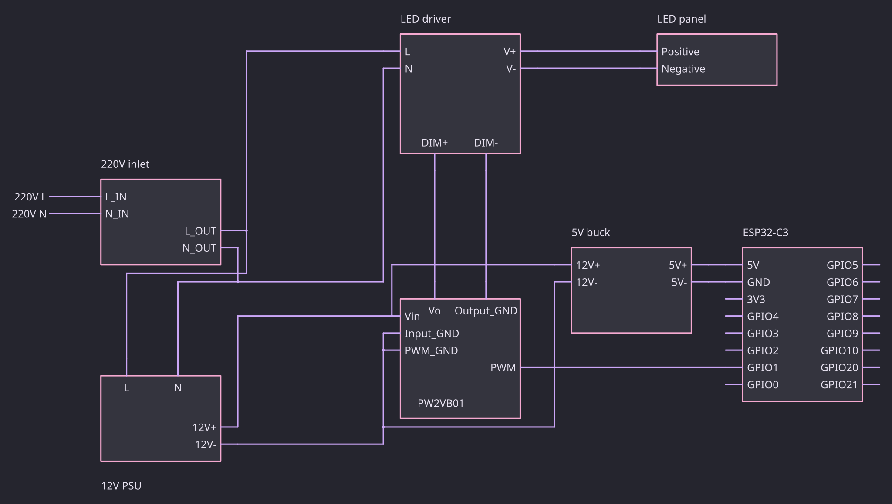

# Schematic

## Requirements

### Inlet
```
Input live - mains cable live
Input neutral - mains cable neutral
Output live - XLG live input and 12 V supply live input
Output neutral - XLG neutral input and 12 V supply neutral input
```

### XLG-100-H-AB LED driver
```
Live input - inlet output live
Neutral input - inlet output neutral
V+ - LED panel positive
V- - LED panel negative
DIM+ - PW2VB01 Vo
DIM- - PW2VB01 output GND
```

### LED panel
```
Positive - XLG V+
Negative - XLG V-
```

### 12 V AC/DC supply
```
Live input - inlet output live
Neutral input - inlet output neutral
12 V positive output - PW2VB01 Vin and buck converter input positive
12 V negative output - PW2VB01 input GND, PW2VB01 PWM GND and buck converter input negative
```

### 5 V buck converter
```
Input positive - 12 V supply positive output
Input negative - 12 V supply negative output
Output 5 V - ESP32-C3 SuperMini 5V
Output negative - ESP32-C3 SuperMini GND
```

### ESP32-C3 SuperMini
```
5V - buck converter output 5 V
GND - buck converter output negative
GPIO1 - PW2VB01 PWM
```

### PW2VB01
```
Vin - 12 V supply positive output
Input GND - 12 V supply negative output
PWM GND - 12 V supply negative output
PWM - ESP32-C3 SuperMini GPIO1
Vo - XLG DIM+
Output GND - XLG DIM-
```

Configure the PW2VB01 for 0 to 10 V output.

## Implementation



The [LibrePCB project](librepcb/sunrise-lamp.lpp) is the source. From the repository root:

```sh
nix develop
open-schematic
render-schematic
```
